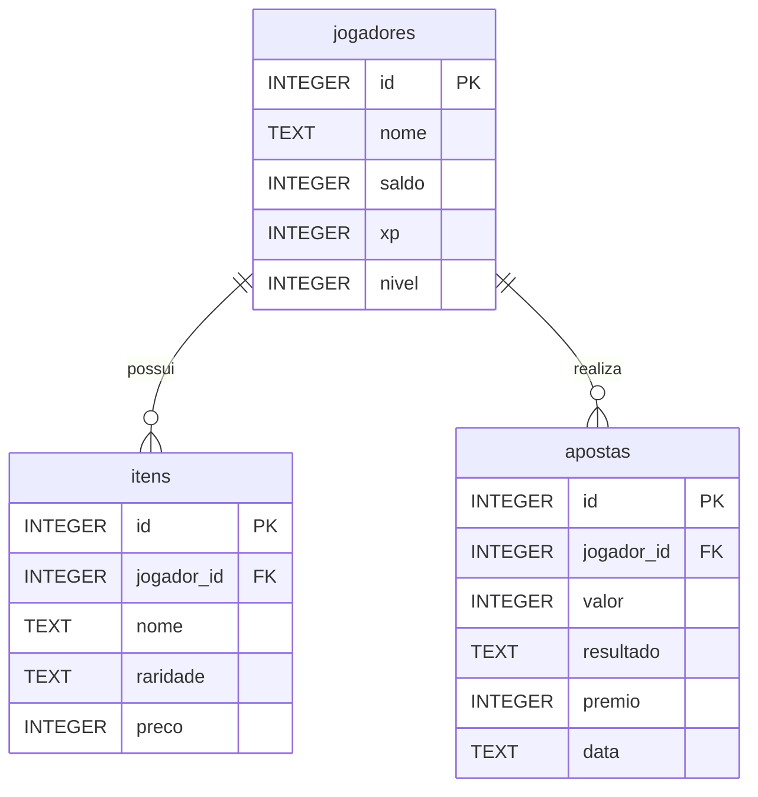

# Diagrama entidade-relacionamento

Cada jogador pode possuir zero ou vários itens e realizar zero ou várias apostas. Cada item e aposta pertence a exatamente um jogador. A exclusão do jogador remove os registros relacionados por ON DELETE CASCADE. O catálogo da loja é definido no Python; a tabela itens registra as compras individuais.
